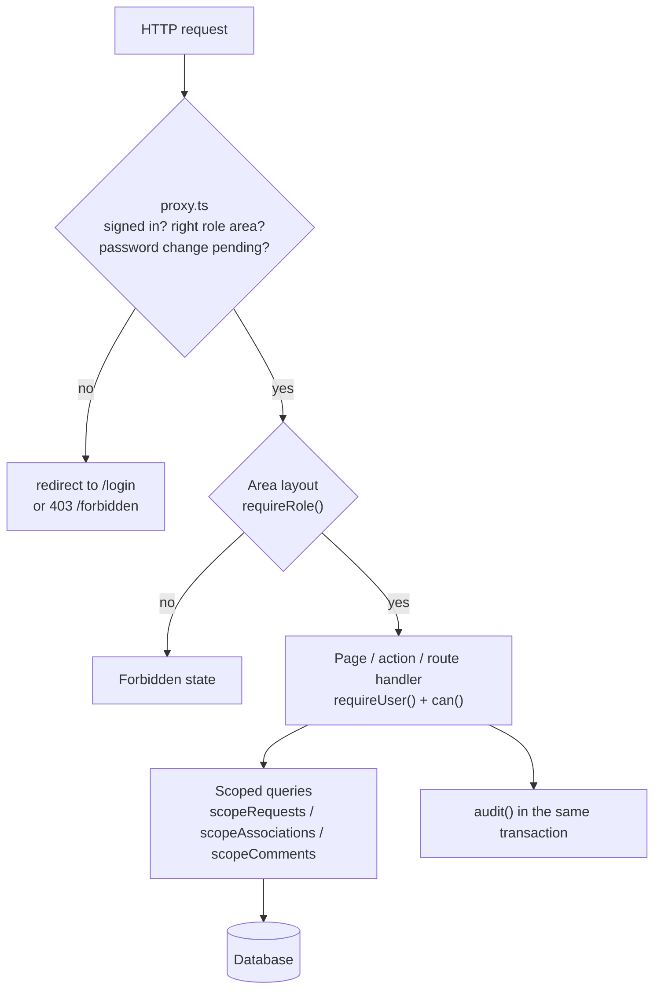
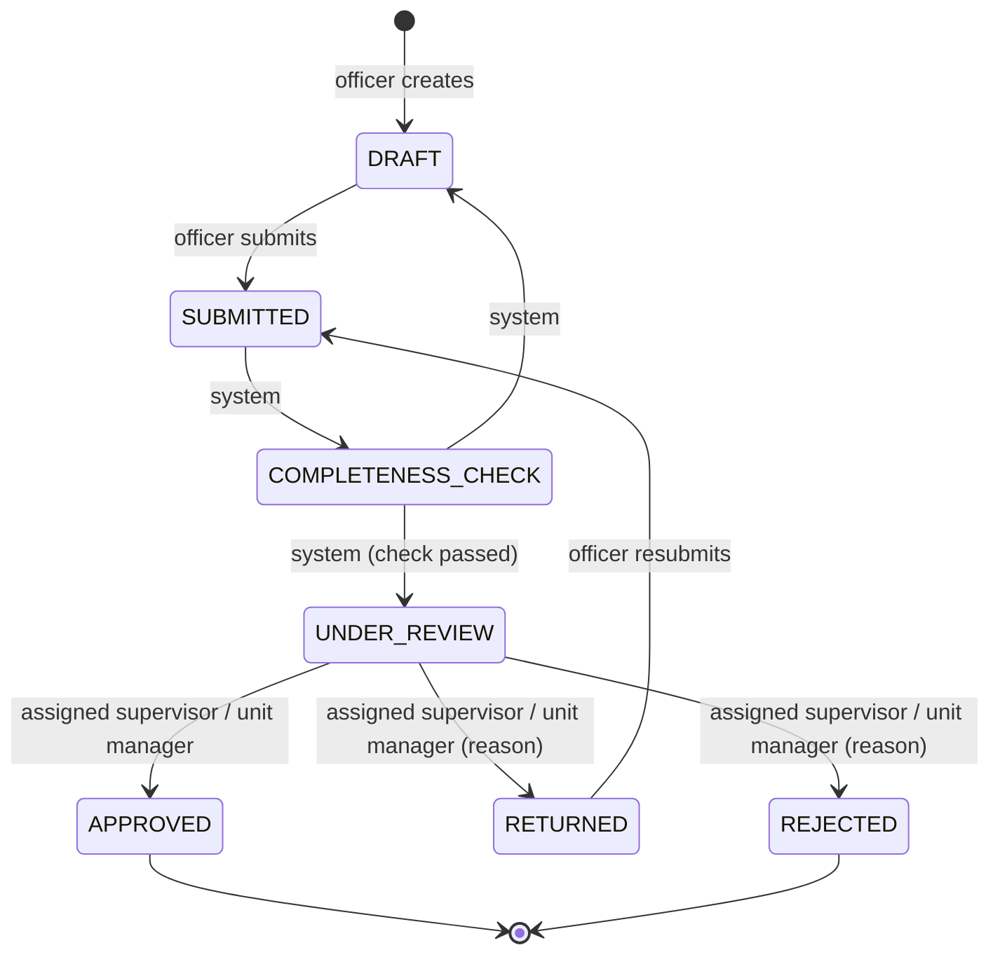
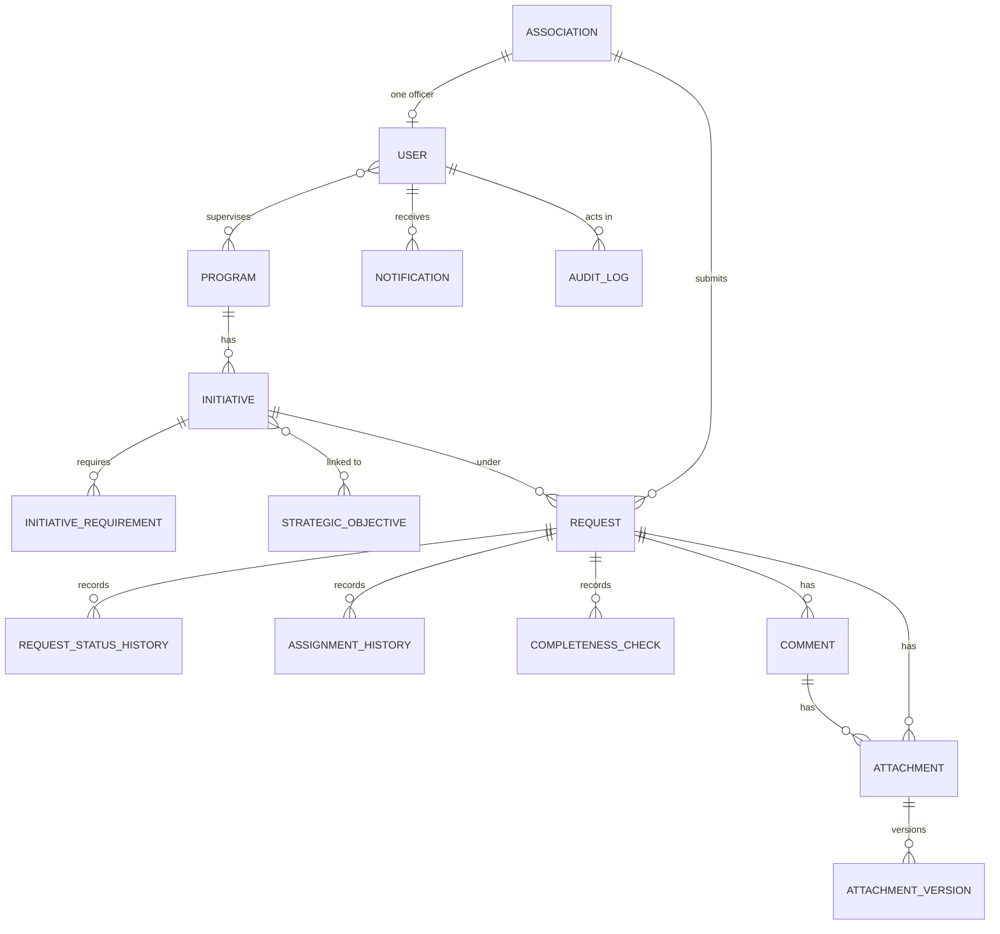
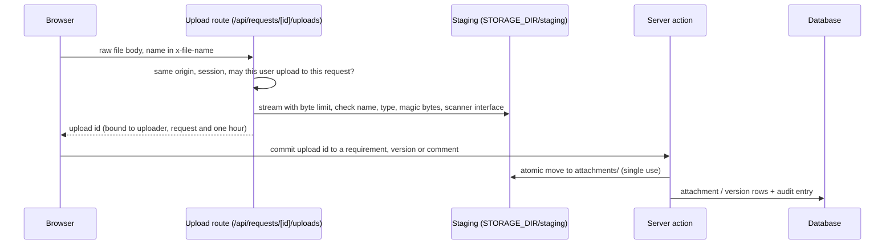

# Architecture

Rifada is one Next.js application (App Router) backed by PostgreSQL. Everything that touches data
runs on the server: pages are React Server Components, mutations are server actions or route
handlers, and every read and write is authorised on the server. Decisions behind each part are in
[DECISIONS.md](DECISIONS.md); the permission matrix is in [PERMISSIONS.md](PERMISSIONS.md).

## System context

```mermaid
flowchart LR
  officer["Association officer<br/>مسؤول الجمعية"]
  supervisor["Supervisor<br/>مشرف"]
  manager["Unit manager<br/>مدير الوحدة"]
  admin["Super admin<br/>مدير النظام"]

  subgraph app["Rifada (Next.js 16)"]
    proxy["src/proxy.ts<br/>session + role area"]
    pages["Pages (RSC)<br/>src/app/(app)/&lt;area&gt;"]
    actions["Server actions<br/>src/server/actions"]
    routes["Route handlers<br/>src/app/api"]
    services["Services<br/>src/server/services"]
    authz["authz: can() + scopers<br/>src/server/authz"]
  end

  db[("PostgreSQL<br/>Prisma 7")]
  disk[("Local file storage<br/>STORAGE_DIR")]

  officer & supervisor & manager & admin --> proxy --> pages
  pages --> services
  actions --> services
  routes --> services
  services --> authz
  services --> db
  routes --> disk
  services --> disk
```

## Request authorisation layers

Scopes: the super admin and the unit manager read every submitted request; a supervisor reads the
requests of the programmes assigned to them; an officer reads only their own association's
requests. Drafts are private to their association: every staff scope excludes requests that have
never been submitted (D-079). Internal notes are removed for officers in `scopeComments` (D-086).

## Request lifecycle

Statuses and transitions are data (editable names and colours, fixed keys). The default lifecycle:

Submission runs in one transaction: the rule-based completeness check (persisted whether it passes
or not), the reference number `RF-<hijriYear>-<seq>`, the status history, the requirements
snapshot, the SLA due date in working days (Sunday to Thursday, Asia/Riyadh) and the automatic
assignment (fewest open requests, then least recently assigned, then username). Decisions use
conditional updates so a double click or a concurrent decision is reported as skipped (D-085).

## Data model (main entities)

The schema is `prisma/schema.prisma`; migrations are additive and live in `prisma/migrations`.

## File uploads

Files are served only by `GET /api/requests/[id]/files/[versionId]` as attachments, after the same
scope checks as the request page. The malware scanner is an interface with a no-op implementation
until a real scanner is chosen (D-076): files are **not** scanned today.

## Code layout

| Path | Contents |
|---|---|
| `src/app/(public)`, `(auth)`, `(account)`, `(app)/<area>` | Public pages, sign-in pages, signed-in pages outside a role, role areas |
| `src/app/api` | Route handlers (auth, uploads, downloads) |
| `src/server/auth` | Better Auth configuration, session helpers, user creation |
| `src/server/authz` | Roles, permission matrix, query scopers |
| `src/server/services` | Domain services (admin, taxonomy, requests, notifications, audit, dashboard) |
| `src/server/actions` | Thin server actions over the services |
| `src/server/storage`, `src/server/uploads` | Storage interface (local disk), upload staging pipeline |
| `src/components` | UI primitives, layout shell, admin, taxonomy and request components |
| `src/lib` | Isomorphic helpers: formatting, validation schemas, completeness rules, working days |
| `prisma` | Schema, migrations, seed data and scripts |
| `tests/unit`, `tests/integration` | Vitest suites (integration against `TEST_DATABASE_URL`) |
| `scripts` | Contrast check, UI rules, permissions doc generator, password reset, safe delete |
